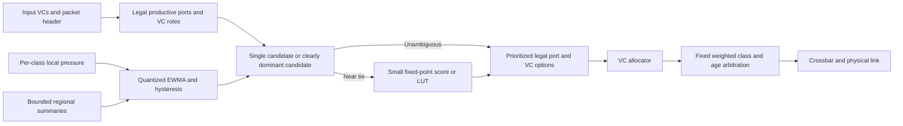

# Future work: a scalable hybrid routing research candidate

## Objective and claim boundary

Develop a hybrid whose latency/throughput/implementation-cost tradeoff improves
on the measured DyAD-OE and TOPSIS-OE baselines, especially on 16x16–64x64 meshes.
This is an **untested research hypothesis**, not an implemented fourth algorithm,
patentability claim, or established state of the art. No algorithm can universally
beat every routing policy on every traffic pattern or bypass mesh cut capacity.
“Faster” must distinguish router critical path, packet tail latency, delivered
throughput, and simulation runtime; “efficient” must distinguish area, energy per
delivered bit, fairness and bandwidth utilization.

## Literature anchors

* Hu and Marculescu, **DyAD: Smart Routing for Networks-on-Chip**, DAC 2004,
  DOI [10.1145/996566.996638](https://doi.org/10.1145/996566.996638),
  [paper](https://www.cs.york.ac.uk/rts/docs/SIGDA-Compendium-1994-2004/papers/2004/dac04/pdffiles/p260.pdf).
  Its compatible deterministic/adaptive modes motivate a cheap fast path. The
  original paper explicitly cautions against an unrestricted XY/OE combination.
* Gratz, Grot and Keckler, **Regional Congestion Awareness for Load Balance in
  Networks-on-Chip**, HPCA 2008,
  [author-hosted paper](https://www.cs.utexas.edu/~skeckler/pubs/hpca08.pdf).
  Regional summaries address the short horizon of greedy neighbor-only routing.
* **Fault tolerant and quality of service aware routing algorithm based on
  priority technique for scalable network on chip architectures**, Scientific
  Reports 2025, [paper](https://www.nature.com/articles/s41598-025-20381-3).
  A relevant TOPSIS route-selection comparison; reproducing its fault model,
  criteria, timing and traffic is required before claiming to outperform it.
* **Q-RASP: A Reinforcement Learning Framework with Region-Awareness and Shared
  Path Experience for Efficient Routing in Networks-on-Chip**, 2023,
  [primary preprint](https://arxiv.org/abs/2307.11712).
  A stronger learning-based comparator than XY alone; include training overhead,
  convergence, state memory, and unseen workloads in comparisons.
* Kondoth et al., **A survey of adaptive routing techniques in two-dimensional
  network-on-chip architectures**, IEEE Communications Surveys & Tutorials,
  [DOI](https://doi.org/10.1109/COMST.2025.3636503),
  [institutional record](https://ro.ecu.edu.au/ecuworks2022-2026/7415/).
  Use its taxonomy to expand the benchmark set. Its institutional record lists
  a 2026 publication date. This search is a starting bibliography, not an
  exhaustive priority or novelty review.

## Proposed architecture

### Updated comparator screen (14 October 2026)

The 2025 [DAHR article](https://www.mdpi.com/2079-9292/14/5/845)
and [PcaDAHR article](https://doi.org/10.1016/j.mejo.2025.106811) are direct
novelty checks for a deterministic/adaptive hybrid. PcaDAHR's publisher abstract
describes source-side path selection using adjacent congestion and carrying the
path in the head flit. Therefore, "choose a route cheaply before injection" is
not by itself a new contribution. Only abstracts/metadata were available in this
screen; obtain full algorithm and legality details before implementing a comparator.

RCA already established bounded regional information, and Q-RASP combines regional
state with shared learning experience. A credible contribution must establish a
specific benefit beyond combining these familiar ideas. The proposed research
question is whether class-specific service pressure, bounded-cost regional
selection, and explicit tail-risk objectives improve held-out critical p99 while
preserving best-effort progress at a measured hardware cost. This is a hypothesis,
not a novelty finding or a performance result.

Do not treat optical, 3D thermal, dual-layer or FPGA-placement results as direct
equal-resource baselines for the current 2D electrical mesh. They may offer design
ideas but change topology, medium or the problem being optimized.

### How the current experiments guide the next prompt

1. Use the same-trace QoS/control deltas to separate scheduling gains from routing
   gains. Keep the scheduler fixed when evaluating the future route selector.
2. Inspect per-class backlog and deadline misses whenever critical p99 improves;
   a favorable completed-packet tail alone does not establish better service.
3. Compare all three hotspot locations. A common throughput plateau near the
   destination's ejection capacity suggests a sink limit, where changing routes
   cannot provide extra capacity. This diagnosis requires the completed data.
4. Where XY remains competitive, test whether local adaptive decisions concentrate
   traffic or react to short-lived credit changes. Regional summaries and hysteresis
   are candidate remedies, not predetermined explanations of current results.
5. Preserve the low-load fast path and account for route-decision delay. The
   cross-simulator calibration already measures different zero-load cycle counts,
   so performance claims must specify the microarchitecture and clock assumptions.

The new selector remains unimplemented until the user's next prompt. Freeze its
tuning set separately from evaluation seeds; the current showcase is baseline
evidence and must not be used as the only held-out test for a subsequently tuned design.

### QoS status and required next stage

The frozen baseline adapter accepts one traffic class. The separately built
QoS adapter now supports critical/best-effort classification, class VC pools,
3:1 weighted local arbitration, age-only matched control, backlog, per-class
tails and synthetic deadline outcomes. Directed validation passed; the full
showcase sweep is in progress. These are simulator-level checks, not original
RTL validation or hard service guarantees. See QOS_EXPERIMENT_PROTOCOL.md.

The predeclared showcase has 25% critical and 75% best-effort demand, with a
synthetic critical target of 16*k cycles. Before evaluating the hybrid use the
same total load and buffer/VC budget for every baseline. Record generated,
injected, delivered and pending demand by class; unfinished packets cannot be
silently excluded from deadline success. Assign packet classes on a common
traffic trace independently of the route choice.

Implement routing and scheduling as separate changes. A candidate scheduler is
work-conserving weighted service with age promotion and a best-effort service
floor. Test it with XY as well as adaptive routing: otherwise priority gains
could be incorrectly credited to the new route selector. Priority alone does
not establish a hard latency guarantee; admission control, arrival constraints
and a schedulability/service-bound argument would be required for that claim.
See the distinction illustrated by [guaranteed-QoS NoC design using routing
and periodic scheduling](https://arxiv.org/abs/1509.00249).

Preserve equal resources when partitioning VCs. An exploratory four-VC design
could allocate two VCs per traffic class; if adaptive/escape roles are used,
prove the permitted channel/VC transitions and account for the lost pooling.
Do not combine unrestricted XY and OE modes. An OE-only candidate is safe within
its verified turn set. A separate west-first candidate can include an XY fast
path within a single legal turn set, as described below; do not mix these two
turn models opportunistically in the same VC class.

Primary QoS evidence: per-class p99, delivered throughput, best-effort starvation
and deadline misses when deadlines exist. Compare fairness within comparable
classes/flow demands, not raw equality across classes deliberately assigned
different service weights. Keep the presentation compact; auxiliary diagnostic
tables can hold backlog, service shares and control overhead.

Freeze tuning on training traffic, then test unseen mixes, burst lengths and
hotspot migration. Ablate scheduler only, routing only, combined design, signal
smoothing, regional information and tie-breaking. Report the cost of each
feature and regressions, including the XY uniform-traffic target. Candidate
novelty and any SOTA claim require an updated literature/reproducibility review;
beating only the three project variants is insufficient.

### Additional recent-work screening (14 October 2026)

This is a targeted literature screen, not an exhaustive novelty review or a set
of reproduced baselines. Publisher abstracts are distinguished from full methods.

- [PND3QN, WCNC Workshops 2026](https://ieeexplore.ieee.org/abstract/document/11555293)
  uses reinforcement learning to select among routing algorithms as injection
  rates vary, evaluated with gem5 under uniform traffic according to its
  publisher abstract. Adaptive algorithm selection is therefore prior art.
  Our proposed per-hop class-aware rule must be compared on decision cost,
  legal turns and service outcomes; a claim that merely switching algorithms
  is novel would be unjustified. Full methods/code were not reviewed here.
- [ALCAR, Microelectronics Journal, August 2026](https://doi.org/10.1016/j.mejo.2026.107268)
  combines regional congestion decisions with a dual-layer network. The
  publisher abstract describes a 13x13 baseline and 2x2 hierarchical layer.
  This is relevant to future topology co-design, but its reported improvements
  cannot be treated as a same-resource, plain-mesh routing baseline without
  accounting for the extra layer, links and timing. Abstract-level screening
  only; no numerical improvement claim is adopted here.
- [The Road Less Traveled](https://arxiv.org/abs/2608.17266) jointly considers
  FPGA placement and turn-model/SAT NoC routing and links an implementation
  in VTR. It was posted to arXiv in August 2026 but identifies its publication
  as FPL 2024. This concerns placement-time optimization, so it informs a later
  mapping study rather than establishing an equivalent online route selector.
- [Choudhary et al., IEEE Access 2026](https://ieeexplore.ieee.org/abstract/document/11435986/)
  is an additional fault-tolerant, congestion-aware Q-learning candidate to
  screen before a SOTA submission. The publisher title/record was located,
  but the primary full text could not be retrieved in this review. No detailed
  implementation or performance claim is made from secondary summaries.

Practical QoS remains application-specific: AMD's
[2026.1 planning guide](https://docs.amd.com/r/en-US/ug1504-acap-system-solution-planning-methodology/NoC-Throughput-and-Latency)
describes traffic-class-dependent QoS tuning, including isochronous and
best-effort uses. This supports evaluating different service needs; it does
not prescribe our 3:1 weight, validate the synthetic deadline, or make our
router a model of that commercial device.

### Routing datapath candidate

QoS-aware adaptive routing itself is established prior art: the
[Wang–Bagherzadeh institutional manuscript record](https://escholarship.org/uc/item/6p176798)
already combines service classes, dynamic arbitration and congestion-sensitive
path selection. Likewise,
[adaptive weighted round-robin arbitration](https://doi.org/10.1049/iet-cdt.2015.0049)
has been studied for global service fairness. Novelty must be in a demonstrably
different, useful decision mechanism and its cost/performance evidence.

The [HARE study](https://link.springer.com/article/10.1007/s10766-018-0614-6)
separates fabric congestion from endpoint congestion and uses destination/VC
history to limit congestion spreading. Its BookSim setup differs materially
from ours: the default uses ten VCs, one-flit packets and internal speedup two.
It also reports a uniform-traffic advantage for dimension-order routing in its
fixed-packet evaluation. For our candidate, this motivates an optional
destination-history/VC-selection ablation alongside class-aware pressure.
That is a design hypothesis, not a diagnosis of our traces. Keep the four-VC
budget and scheduling fixed, charge history state, and recheck deadlock rules.
Evaluate whether unaffected traffic is protected when a hotspot exceeds sink
capacity; detours cannot add destination bandwidth. HARE/Footprint are relevant
comparison candidates if endpoint isolation becomes part of our contribution.

The completed 4x4 uniform subset gives a concrete **preliminary** motivation for
class-aware pressure. At offered load 1, XY's weighted/control critical p99 means
are approximately 50.7/8105.7 cycles, but best-effort p99 is 14596/8860 and total
throughput is 0.5588/0.6508 flits/node/cycle. This is an overloaded finite-window
tradeoff, not a full-study result. Exact values, three-seed intervals and all
policies are in `results/qos_preview` while the larger sweep continues.

The completed 4x4 transpose case at load 1 has a different outcome: weighted
throughput means are 0.5840 for XY, 0.6261 for DyAD-OE and 0.6317 for TOPSIS-OE.
The paired XY-minus-adaptive throughput intervals exclude zero at the exploratory
pointwise 95% level. Critical p99 means are 264.7, 58.0 and 57.3 cycles respectively,
but the paired latency intervals include zero because XY varies strongly across
the three seeds. These are promising workload-dependent observations, not a
general superiority claim or a substitute for more seed coverage in future work.
See `paired_routing_differences.csv`; these intervals are not multiplicity-adjusted.

The completed highest-load 8x8 uniform case (load 0.5 flits/node/cycle) reinforces
the tradeoff. Weighted-service critical p99 means are 77.0 / 81.0 / 81.3 cycles
for XY / DyAD-OE / TOPSIS-OE, while total throughputs are 0.2963 / 0.2302 / 0.2316.
For XY, switching from age-only to weighted service changes critical p99 from
5372.7 to 77.0 but best-effort p99 from 7897.3 to 13459.0 and throughput from
0.3544 to 0.2963. These three-seed, finite-window results motivate improving
route efficiency while keeping scheduling fixed; critical latency alone would
hide the best-effort cost. The rest of the 8x8 and larger-mesh study is unfinished.

At the same highest load in the completed 8x8 transpose case, weighted critical
p99 is 3084.7 / 95.7 / 96.3 cycles for XY / DyAD-OE / TOPSIS-OE. XY's three
seed values are 2828, 3179 and 3247; both adaptive variants stay between 95 and
98. Critical eligible deadline misses are 31.798% / 0.0094% / 0.0021%, which
also accounts for unfinished eligible packets. Total throughputs are
0.25386 / 0.26854 / 0.27190. These finite-window measurements support testing
traffic-dependent route adaptation under fixed scheduling; they do not isolate
the contribution of the legal turn set from the pressure selector. Raw cases
are `results/qos_comparison/cases/k8_transpose_l8_s{1,2,3}/weighted_*`.

For the next prompt, test estimated waiting pressure per **class and output**,
instead of assuming total occupied credits predict the service available to a
critical packet. Candidate inputs are class-local outstanding credits, available
class VCs, recent eligible grant/credit-return rate and a bounded regional summary.
An estimated waiting cost could combine `queued_work / estimated_service` with
regional pressure, but computing a divide in the route stage is not the default
implementation: quantize service, precompute estimates off the route critical
path, and compare fixed-point costs. Account for idle-class borrowing and stale
estimates. Class partitioning can make an aggregate congestion signal misleading,
but this must be established by ablation rather than assumed from one plot.

A minimum useful ablation set is current aggregate pressure; class-local pressure;
class-local plus service-rate estimate; and then regional information. Hold the
weighted scheduler constant. Reject a candidate that merely shifts more delay
onto best effort or lowers completed p99 by increasing unfinished demand.

Regional information has a physical budget. For example, sending two 5-bit class
summaries in four directions every four cycles is 20 information bits per router
cycle before framing. Against four 32-bit data links this is already 15.6% of
their aggregate raw bit rate if it consumes those links. Piggybacking is not free
unless spare bits and timing are demonstrated. Event-triggering, compression or
dedicated wires must be charged explicitly in the implementation-cost comparison.

Working description: **regional, event-triggered hybrid with a bounded decision cost**.

Evaluate three distinct legality/VC designs before selecting a final candidate:

* An OE-only branch keeps the current legality machinery in every mode.
* A west-first branch permits an actual XY default path plus legal adaptive
  choices under one common turn restriction. Glass and Ni's
  [original turn-model paper](https://web.csl.cornell.edu/courses/ece5750/glass.isca92.pdf)
  forbids the two turns into west: required westward movement occurs first.
  Our inference is that every minimal XY path is a member of this legal set,
  because XY completes westward motion before any vertical motion. For eastbound
  destinations, productive east/vertical choices remain adaptive. Consequently,
  switching between XY choices and west-first choices within this same legal
  set need not add an escape VC. This requires implementation-level dependency
  checks, but avoids an unrestricted XY/OE union. The limitation is directional
  asymmetry: westbound destinations lose this path diversity. Include a plain
  adaptive west-first comparator to distinguish the turn model's benefit from
  the proposed pressure estimator. West-first itself is established prior art.
  A specific limitation follows for transpose: the westbound sources in row
  `y=0` still all cross the final westward link into `(0,0)`. Thus this branch
  retains the necessary `lambda <= 1/(k-1)` bound for that bottleneck. This is
  our graph-based inference; eastbound improvements do not remove that bound.
* A minimal-adaptive branch can assign one adaptive and one XY escape VC per
  class, retaining the current total of four VCs. Based on
  [Duato's deadlock-avoidance framework](https://www.csl.cornell.edu/courses/ece5750/duato.tpds93.pdf),
  design transitions as adaptive-to-adaptive, adaptive-to-escape and
  escape-to-escape, with no return from an inter-router escape VC. Keep a
  connected, acyclic escape route available at every hop and verify the actual
  allocator's progress conditions. This opens both productive directions
  without the west-first asymmetry, but may lose effective buffer pooling.
  Compare a plain adaptive/escape baseline before adding the proposed score.
  This is a candidate requiring proof and tests, not a claim of a validated
  implementation or automatic uniform-traffic equivalence.

With adaptation and extra control activity disabled, the west-first branch can
select the exact XY routes under the same pipeline. Whether that preserves XY's
measured uniform-traffic performance after adding hardware/control costs remains
an experimental question. Do not infer an overall performance guarantee from
path-set inclusion alone.

The pinned BookSim `min_adapt_mesh` is a useful source reference, not a ready
QoS baseline: its VC ranges follow message type, not our service classes.
Its escape call is `AddRange(out_port, 0, vcBegin, vcBegin)`, whereas the
signature is `(port, vc_start, vc_end, priority)`. A class-preserving port must
use the intended single escape VC and explicit priority, rather than inherit
that range when `vcBegin` is nonzero. None of the active `noc_*` routes uses
this function. Source references: `.deps/booksim2/src/routefunc.cpp:933` and
`src/outputset.hpp:46`. Adapt and validate the class ranges in the next phase.
Nonminimal detours remain a separate later design requiring additional progress
reasoning. Merely naming an escape VC does not prove correctness.

Each router stores per-class estimates for four output directions and a bounded number of directional
regional summaries. Aggregate only within a configurable radius or hierarchy;
do not distribute a full network queue map. Age estimates, expire stale summaries,
and quantize to 3–5 bits. Piggyback changes on credit/control traffic and explicitly
charge for wires, storage, update energy and delay. Evaluate 4, 8 and 16-cycle
update periods and event-only updates; there is no free zero-latency global oracle.

Use two congestion thresholds, e.g. enter adaptive mode at 0.65 and leave at 0.45,
as a tunable starting point. Use a stable source/destination hash for equal-cost
ports to avoid synchronized herding, provided it only selects legal ports.
Compare this against deterministic tie order and round-robin ties in ablations.

## Graph-theoretic and arithmetic opportunities

The following bounds are derived for this project's unit-capacity links and
uniform per-node offered flit rate `lambda`; they are not measured saturation points.
For an even square mesh under uniform traffic, expected demand across either
direction of a central vertical cut is `lambda*k*k/4`, while the cut has `k`
directed links. Hence `lambda <= 4/k` is a necessary cut-capacity condition.
For the 20% hotspot / 80% uniform mixture, total demand at the hotspot ejection
port is `lambda*(0.2*k*k+0.8)`, yielding the sink bound used to scale the load grid.
These bounds explain the selected sampling ranges without assuming that any
router can attain them.

Transpose also exposes route-specific concentration: XY sends `(x,y)->(y,x)`
through `(y,y)`. In the outermost source row, `k-1` sources share the final
horizontal link toward that diagonal router, so that link imposes
`lambda <= 1/(k-1)` on this XY permutation under equal source rates. Adaptive
minimal routes may distribute that concentration, but legal turns, downstream
VC availability and the destination-side links still constrain the result.
This is a useful diagnostic prediction to compare against completed sweeps,
not a promise that the project's adaptive baselines will achieve a higher limit.

An exploratory class-service calculation makes a more specific prediction.
If both classes remain eligible at an overloaded output, approximate critical
service by the nominal 3/4 share. The `k-1` transpose sources feeding an outer
XY bottleneck offer critical demand `0.25*lambda*(k-1)`, giving an estimated
critical-pressure point `lambda ~= 3/(k-1)`: 1.0 for 4x4 and about 0.429 for 8x8.
This is **not a bound or guarantee**: borrowing, credits and matching change the
actual service share. It is a hypothesis to check with per-output class-grant
counters in the next instrumentation revision.

Existing 8x8 weighted-XY measurements are consistent with that hypothesis:

| Transpose offered load | Critical p99 mean (cycles) | Critical pending growth, three-seed mean (packets) |
|---:|---:|---:|
| 0.3 | 88.0 | 7.3 |
| 0.4 | 147.3 | 1.3 |
| 0.5 | 3084.7 | 902.7 |

These are exploratory finite-window observations, not a measured stationary
saturation threshold. The candidate should relieve route concentration while
holding arbitration fixed; increasing critical service weights alone would not
test this routing hypothesis and could transfer more delay to best effort.

Avoid assuming a quantized decision table is automatically cheap. With two
candidate ports, three 4-bit criteria per candidate already require 24 input
bits for a direct table (2^24 entries). Even a table indexed by the three signed
criterion differences has 31^3 entries, about 3.7 KiB for one decision bit.
Start with a few shift/add comparisons and a dominant-candidate bypass; only
retain a LUT if synthesis or a documented memory model shows a worthwhile cost.
Constant per-hop complexity alone does not imply acceptable silicon area.

1. **Exploit Manhattan geometry.** In a 2D minimal mesh a hop has at most two
   productive directions. Computing coordinates and a turn-legal mask costs
   constant work; running Dijkstra or A* at every router is unnecessary. Network
   state still scales with node count, but per-hop selection need not.
2. **Pareto filtering before scoring.** If one legal port has no worse local
   pressure, regional pressure and risk estimate, with at least one strict
   improvement, select it without TOPSIS normalization. Measure the percentage
   of decisions resolved here and the resulting critical path.
3. **Remove square roots from pairwise TOPSIS ranking.** Write squared distances
   to ideal and anti-ideal as A_i and B_i. For two alternatives, C_i>C_j iff
   B_i*A_j>B_j*A_i, away from the all-zero tie. This removes distance square
   roots, but normalization/finite-precision effects remain; prove equivalence
   for your arithmetic and handle zero denominators. A precomputed lookup table
   for a small quantized state can remove division from the route stage.
4. **Use channel-dependency graphs as design constraints.** Vertices are directed
   channels (and VC classes); edges represent permitted consecutive holds.
   Check every mode and transition together, not each mode in isolation. Strict
   Manhattan descent prevents livelock in fault-free minimal routing but alone
   does not prove freedom from wormhole deadlock.
5. **Use cut bounds to judge scalability.** For any cut, sum the demand crossing
   it and compare with directional link capacity. An even k-by-k mesh has k
   links per direction across a vertical bisection while potential cross-cut
   senders grow quadratically. Per-node offered capacity can therefore fall as
   O(1/k) under cross-cut traffic. Routing cannot create extra bisection bandwidth.
6. **Treat topology and routing as separate experiments.** Express links, torus
   wraps, concentration and hierarchical meshes can change diameter/bisection
   capacity, but alter wire length, timing and area. Compare under equal resource
   budgets; do not attribute a topology advantage solely to the routing policy.

## Evaluation needed for a credible SOTA claim

Start with fault-free meshes and establish a reproducible baseline. Expand to
8x8, 16x16, 32x32 and 64x64, more seeds and long runs; extend to rectangular
meshes only after removing the current square-mesh assumption. Use uniform,
transpose, tornado, bit-complement, clustered, hotspot, bursty and application
traces. Sweep load densely near saturation; define saturation by sustainable
throughput and growing backlog across longer windows, not one latency threshold.

Compare against XY, OE-fixed, adaptive OE, DyAD-OE, TOPSIS-OE, RCA and at least one
recent reproducible strong baseline. Use matched buffers, VC budgets, packet
sizes, clock targets and allocator assumptions. Tune on separate workloads and
freeze weights/thresholds before test workloads. Publish negative results.

Primary endpoints: mean/p50/p90/p99 latency, accepted throughput, source backlog,
per-flow/per-class fairness (including Jain's index), starvation/tail bounds,
deadline misses, control overhead, and energy per delivered bit. Obtain energy
and area from a calibrated model or synthesis; wall time and occupancy are not
energy measurements. Include route-computation latency sensitivity (1/2/3 cycles)
and fixed-point precision sensitivity; report results at equal clock frequency
and equal area where possible.

Ablate each addition: threshold only; +hysteresis; +local dominance test; +regional
signals; +quantized LUT; +fair scheduling. Measure how often the expensive path
runs and how stale regional signals affect routing. Test traffic phase changes,
adversarial synchronized sources and hotspot migration. Faults and nonminimal
routing are separate later milestones because the current reachability proof no
longer applies when minimal paths fail.

Provisional success criteria (targets, not results): >10% geometric-mean p99
latency improvement on held-out congested workloads over both project baselines;
no more than 2% low-load latency regression; improved sustainable throughput;
and equal or lower energy per delivered bit within a stated area budget. Publish
confidence intervals and workload-level regressions. Only after comparison with
current strong baselines should the work be described as a SOTA candidate.
